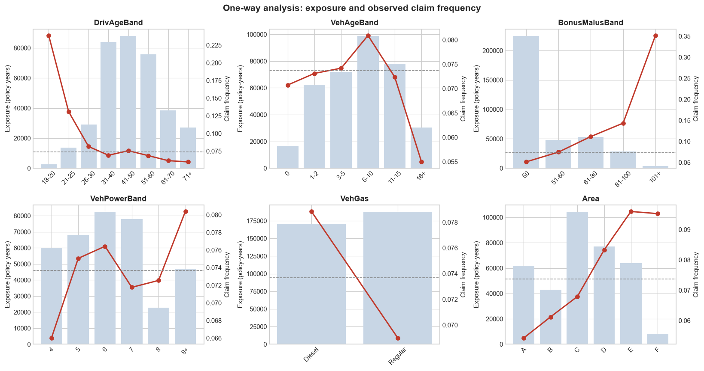
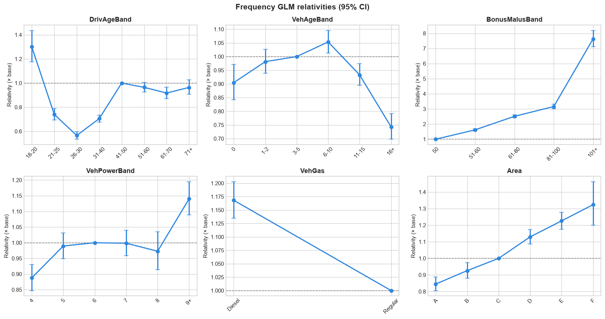
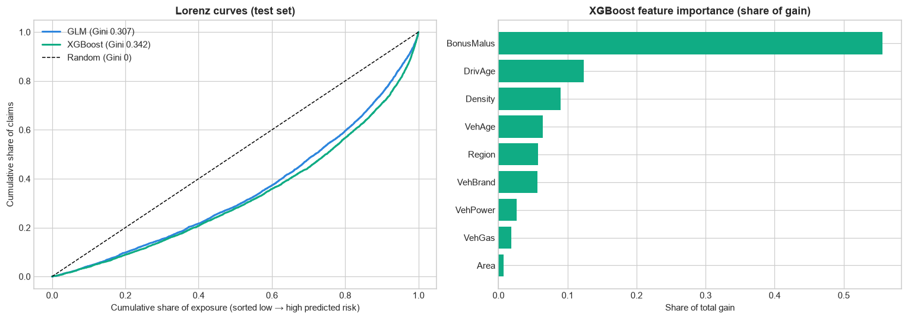

# Motor Insurance Pricing with GLMs

A motor insurance pricing model built on **678,013 real French motor policies** (freMTPL2). It estimates each policy's expected annual claims cost (the *pure premium*) with the standard actuarial **frequency × severity GLM** approach, turns it into a rating tariff, and compares it against XGBoost.

### 👉 [Try the live premium calculator](https://motor-insurance-pricing.streamlit.app/)

> Built with AI-assisted coding (Claude). The modelling choices, results and their interpretation are documented below and in the notebook.



## Results at a glance

| | |
|---|---|
| Policies / exposure | 678,013 policies, 358,360 policy-years |
| Claim frequency | 0.074 paid claims per policy-year |
| Average pure premium | ≈ €167 per policy-year |
| Strongest rating factor | Bonus-malus: worst band claims **7.6×** as often as best |
| Frequency GLM Gini (test) | **0.307** |
| XGBoost Gini (test) | **0.342** |
| Model balance (test) | predicted / actual cost = 1.00 |

## Method

1. **Cleaning** ([`src/prep.py`](src/prep.py)): capped exposure at 1 year, capped claim counts at 4, rebuilt claim counts from paid claims only, capped individual claims at €50k, and banded continuous variables.
2. **Frequency model**: Poisson GLM with a log link and a `log(exposure)` offset, so it models claims per policy-year.
3. **Severity model**: Gamma GLM with a log link on the average capped claim per policy, weighted by claim count.
4. **Pure premium** = frequency × severity × large-loss loading (+29.9%, which spreads the cost above the €50k cap across all policies).
5. **Validation** on a 20% hold-out: balance check, Lorenz curve / Gini, and lift chart by decile.
6. **Benchmark**: XGBoost with a Poisson objective and the same exposure offset, using raw (unbanded) features.
7. **Premium calculator**: a Streamlit app that applies the tariff to any driver profile.



## Key findings

- **Bonus-malus dominates.** It is the policyholder's own claims history, so it is the best predictor of future claims.
- **One-way analysis misleads.** 18–20 year-olds look 3.2× riskier than 41–50 year-olds on raw data, but only 1.3× in the GLM, because young drivers start on a high bonus-malus. Pricing from one-way tables would double-count the effect.
- **Large losses drive cost.** 88 claims above €50k (0.3% of claims) make up about 30% of total cost.
- **Severity is hard to predict.** Most severity relativities are not statistically significant, so most of the price differentiation comes from frequency.
- **GLM vs ML.** XGBoost ranks risk better (Gini 0.34 vs 0.31), but the GLM captures most of the signal with about 50 transparent parameters. That is why GLMs remain the industry standard for tariffs: they are explainable, they satisfy regulators (e.g. FCA Consumer Duty) and they can be adjusted by actuarial judgement.



## Limitations and next steps

- 9,116 claims with no payment recorded were treated as nil claims. If they are actually missing data, frequency is understated by about 25%.
- Only one year of data, so there is no claims inflation, trend or stability testing.
- Pure premium only; a real price adds expenses, reinsurance, cost of capital, profit and demand/competitor effects.
- Large losses use a flat loading; a separate large-loss model (e.g. a Pareto tail) would allocate them better.
- No interaction terms. XGBoost could be used to find which ones (e.g. age × power) are worth adding to the GLM.
- Sparse levels (small regions, 18–20 drivers) could be stabilised with smoothing or credibility weighting.
- Rating factors such as location should be tested for indirect discrimination.

## Run it yourself

```bash
python -m venv .venv
.venv\Scripts\activate            # Windows  (macOS/Linux: source .venv/bin/activate)
pip install -r requirements.txt
python src/download_data.py       # fetches freMTPL2 from OpenML into data/
jupyter notebook notebooks/motor_pricing.ipynb
streamlit run app.py              # premium calculator (live: https://motor-insurance-pricing.streamlit.app/)
```

## Project structure

```
├── notebooks/motor_pricing.ipynb   # full analysis, with explanations
├── src/prep.py                     # data cleaning, banding, Gini
├── src/download_data.py            # data download
├── app.py                          # Streamlit premium calculator
├── models/tariff.json              # exported base premium + relativities
└── figures/                        # charts used in this README
```

## Data

freMTPL2freq / freMTPL2sev from the R package `CASdatasets` (Dutang & Charpentier), via OpenML (IDs 41214 and 41215).
